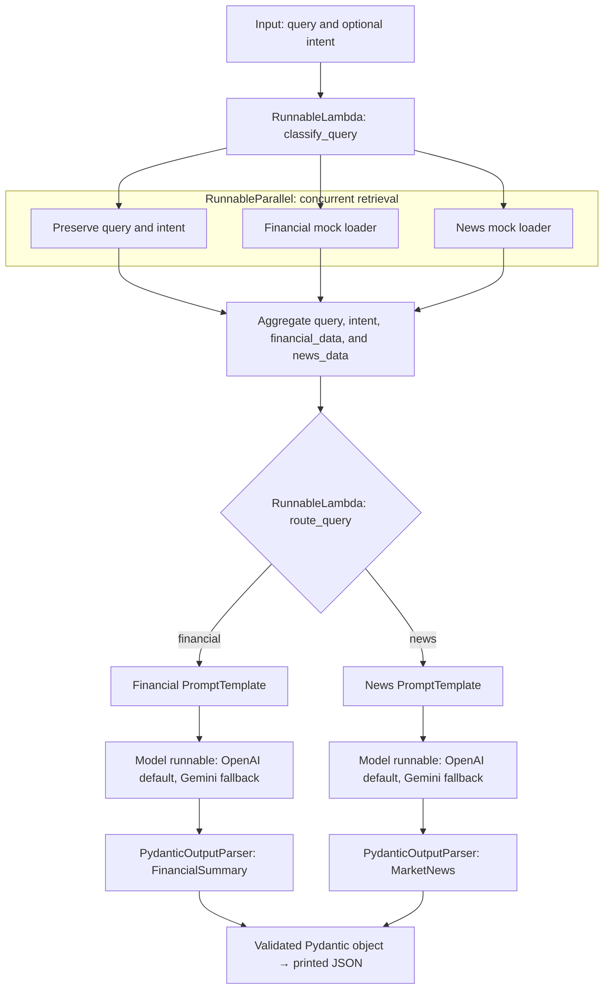

To: Dr. Aisha Rahman — Lead AI Architect
Subject: FinCorp LCEL Proposal — Schema-Driven Parallel Retrieval and Dynamic Routing

Dear Dr. Rahman,

I propose a FinCorp proof of concept that combines concurrent mock document retrieval, dynamic routing, reusable prompts, and Pydantic output validation. The implementation in `workflow_architecture.py` preserves the starter architecture and uses `ChatOpenAI` with GPT-4o-mini as its default inference model. Retrieval is simulated as permitted by the assignment; model inference uses a real API.

### Routing strategy

A `RunnableLambda` wraps `classify_query()`. The function accepts a supplied `financial` or `news` intent, or classifies the question using explicit financial and news keywords. Empty questions, invalid intents, and queries matching both or neither category are rejected unless a valid intent is supplied. This simple classifier is transparent and inexpensive, although it cannot understand every natural-language formulation.

After retrieval, a second `RunnableLambda` wraps `route_query()`. It reads the classified intent and returns either the financial inference chain or the news inference chain. LangChain executes the returned runnable with the current input. Only the selected inference branch runs; the workflow does not generate both summaries for one question.

### Parallel retrieval

`RunnableParallel` runs `fetch_structured_financials()` and `fetch_unstructured_news()` concurrently. It also preserves the question and intent. The aggregate dictionary contains `query`, `intent`, `financial_data`, and `news_data`.

The loaders return clearly labeled fictional TechGlobal Corp records. The financial record contains Q2 2023 revenue and net income in millions. The news record contains three fictional headlines and a supplied aggregate sentiment score. The news chain extracts that score; it does not independently calculate sentiment. These fixed loaders demonstrate orchestration and do not search for arbitrary companies or periods.

For real independent I/O operations, parallel retrieval can reduce retrieval latency from approximately the sum of both loader durations toward the slower duration plus orchestration overhead, assuming sufficient concurrency. The current in-memory mocks are too small to demonstrate a meaningful speed improvement.

Both loaders run for every accepted question, even though only one inference branch uses its corresponding source. This demonstrates the required multi-source aggregation, but a failure in either loader would fail the aggregate stage. A production version could route before retrieval to avoid unnecessary requests, with a different execution design.

### Reusable prompts and LCEL composition

The financial prompt declares `{query}` and `{financial_data}` as runtime placeholders. The news prompt declares `{query}` and `{news_data}`. `RunnableParallel` supplies the matching dictionary keys. Each parser's `get_format_instructions()` fills `{format_instructions}` through `partial_variables` when the prompt is constructed. Inline comments in the Python file document these mappings.

Each branch uses a linear LCEL sequence:

```text
PromptTemplate | model runnable | PydanticOutputParser
```

The complete workflow is:



### Linear-chain and router-chain trade-offs

Linear chains are appropriate inside each inference branch because prompt formatting, inference, and parsing depend on the preceding step. This ordering is simple to inspect and debug.

A single extended linear chain would be less suitable for FinCorp's independent retrieval sources and alternative output contracts. Sequential source calls would add their latencies, while a fixed inference path would need additional conditional handling to choose the correct prompt and parser.

Parallel retrieval and router chains express these concerns directly: independent loaders run together, and the classified intent selects one schema-specific branch. The costs are a more complex intermediate dictionary, explicit classification rules, and additional branches to maintain. This is a bounded routed workflow rather than an autonomous planning agent.

### Pydantic contracts and noise containment

`FinancialSummary` requires exactly `company_name`, `quarter`, `total_revenue`, and `net_income`. Quarter labels must match `QX YYYY`, with X between 1 and 4. Amounts are numeric floats in millions; net income may be negative.

`MarketNews` requires exactly `company_name`, `sentiment_score`, and `top_headlines`. Sentiment must be between -1.0 and 1.0, and the headline list must contain exactly three nonempty strings. Both models reject extra fields and nonfinite numbers and enable strict type validation. Field descriptions also guide the model through the parser-generated instructions.

`PydanticOutputParser` parses the selected model response into the corresponding Pydantic class. Missing fields, invalid types, forbidden extra fields, and violated constraints raise errors. Normal execution stops before a malformed object reaches downstream reporting. Successful calls return a `FinancialSummary` or `MarketNews` object, which the CLI serializes as JSON.

Pydantic validates structure and declared constraints, not factual accuracy. A fabricated revenue number or invented headline may still satisfy its field type. The prompts instruct the model to extract only supplied source values, but the current implementation does not independently verify facts or compare every output value with its source. Production use would require trusted retrieval, provenance, and separate factual or source-grounding checks. Prompt instructions alone are not a security boundary against prompt injection.

### Default model and optional Gemini fallback

OpenAI GPT-4o-mini is the default, configured with temperature zero, a request timeout, and automatic retries disabled. Temperature zero reduces sampling variation but does not guarantee correctness.

An optional Gemini fallback supports local execution when an OpenAI key is absent or OpenAI returns a recognized credit/quota-exhaustion error. It uses `ChatGoogleGenerativeAI`, with `gemini-3.5-flash-lite` as the default model and `GEMINI_MODEL` as an override. The Gemini client omits temperature because the default model uses fixed sampling settings.

The program prints which provider is selected and when it switches. Invalid OpenAI credentials, temporary rate-limit errors, network failures, parser errors, and other unrelated failures do not trigger this fallback. If no Gemini key is configured, an OpenAI credit error remains visible. A Gemini failure also propagates; no fabricated response is substituted.

This extension retains the assignment's required OpenAI path. A successful Gemini run demonstrates the LCEL workflow, but does not demonstrate successful GPT-4o-mini inference. Provider access, model availability, pricing, and quotas depend on the configured accounts; Gemini access should not be assumed to be unlimited or free for every account.

### Verification

Local checks exercised classification, parallel aggregation, dynamic routing, schema rejection, model selection, and fallback decisions without credentialed API requests. The observed terminal runs additionally demonstrated successful financial and news outputs through the Gemini fallback after OpenAI reported exhausted credits. Successful OpenAI inference has not yet been demonstrated in this environment.

The execution guide below provides reproducible commands and expected results.

Kind regards,
Mohammed Eid

---

## Execution guide

### 1. Install dependencies

From the repository directory on macOS, with Python 3.12 and uv available:

```bash
uv sync --locked
uv pip check
```

Expected: the locked environment installs successfully and dependency checks pass. The project includes LangChain Core, the OpenAI and Google integrations, Pydantic, and python-dotenv.

### 2. Configure credentials

Create a local `.env` file only if one does not already exist, and edit it with your own values:

```dotenv
OPENAI_API_KEY=your-openai-api-key
GOOGLE_API_KEY=your-google-api-key
GEMINI_MODEL=gemini-3.5-flash-lite
```

These are placeholders, not working credentials. Never commit real keys. No Alpha Vantage key is needed because retrieval uses mocks.

- For OpenAI only, configure `OPENAI_API_KEY` with usable API credits.
- For automatic fallback, configure both provider keys.
- For Gemini directly, omit or leave `OPENAI_API_KEY` empty and configure `GOOGLE_API_KEY`.
- `GEMINI_MODEL` is optional; the code supplies the default shown above.

Existing shell environment variables take precedence over `.env`. If removing the OpenAI key from `.env` does not select Gemini, check whether it is exported in the shell; `unset OPENAI_API_KEY` removes that shell value for the current terminal session.

### 3. Check syntax and available arguments

```bash
uv run python -m py_compile workflow_architecture.py
uv run python workflow_architecture.py --help
```

Expected: compilation completes without output, and help shows `--query` and `--intent`. These checks do not call a model API.

### 4. Run the financial branch

```bash
uv run python workflow_architecture.py
```

The default question asks for TechGlobal Corp revenue and net income for Q2 2023. An explicit equivalent is:

```bash
uv run python workflow_architecture.py \
  --query "Show TechGlobal Corp revenue and net income for Q2 2023."
```

Expected successful financial JSON, based on the fictional fixture:

```json
{
  "company_name": "TechGlobal Corp",
  "quarter": "Q2 2023",
  "total_revenue": 14500.0,
  "net_income": 2100.5
}
```

These amounts are in millions and are assignment examples, not live financial results. A model response is not guaranteed to reproduce them correctly merely because it passes structural validation.

### 5. Run the news branch

```bash
uv run python workflow_architecture.py \
  --query "Show TechGlobal Corp news sentiment"
```

Expected successful news JSON, based on the fictional fixture:

```json
{
  "company_name": "TechGlobal Corp",
  "sentiment_score": 0.65,
  "top_headlines": [
    "TechGlobal announces breakthrough in enterprise AI",
    "Analyst upgrades TechGlobal stock to 'Strong Buy'",
    "TechGlobal faces minor supply chain disruptions in Q2"
  ]
}
```

### 6. Supply an explicit classification

A question without recognized keywords needs `--intent`:

```bash
uv run python workflow_architecture.py \
  --query "Summarize the supplied TechGlobal Corp information" \
  --intent news
```

Expected: the news branch runs. `--intent financial` selects the financial branch instead. Explicit intent overrides keyword classification; it does not change the fixed mock records.

### 7. Interpret provider messages

With usable OpenAI credentials:

```text
FinCorp PoC: mock retrieval; OpenAI default with Gemini fallback.
Using OpenAI: gpt-4o-mini
```

With exhausted OpenAI credits and an available Gemini key:

```text
FinCorp PoC: mock retrieval; OpenAI default with Gemini fallback.
Using OpenAI: gpt-4o-mini
OpenAI credits/quota exhausted; switching to Gemini.
Using Gemini: gemini-3.5-flash-lite
```

With only a Gemini key:

```text
FinCorp PoC: mock retrieval; OpenAI default with Gemini fallback.
OpenAI key is missing; switching to Gemini.
Using Gemini: gemini-3.5-flash-lite
```

Successful runs print the selected branch's JSON after these messages. Every invocation with an OpenAI key tries OpenAI first; the script does not remember prior credit failures across runs.

### 8. Understand failures

Without `--intent`, this mixed query is rejected before retrieval and inference, assuming model configuration succeeds:

```bash
uv run python workflow_architecture.py \
  --query "Compare revenue with news sentiment"
```

Expected: `Pipeline failed: Query is ambiguous or unsupported; ...` and an unsuccessful exit.

Missing credentials fail during pipeline construction. Provider failures and invalid model output produce `Pipeline failed: ...` rather than a substitute result. Network access and at least one usable provider account are necessary for a complete run.
